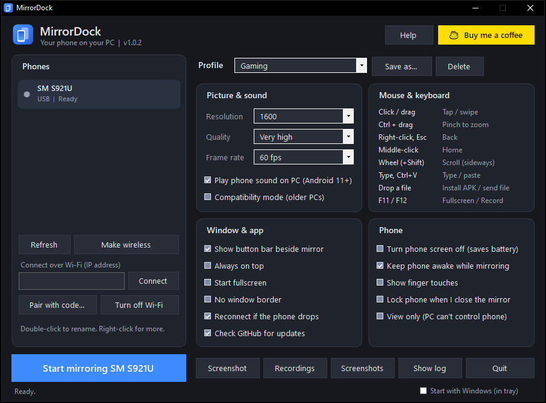
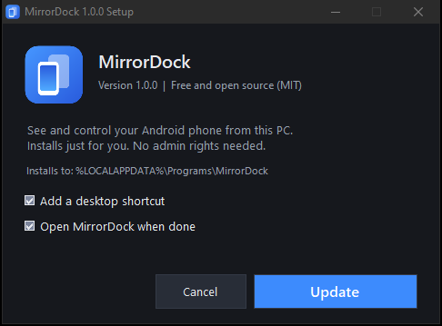

<p align="center"></p>

# MirrorDock

**See and control your Android phone from your Windows PC.** Free, open source, no account, no ads.

Plug in your phone (or connect over Wi-Fi), click **Start mirroring**, and your phone shows up in a window. Then use your mouse and keyboard on it, hear its sound, record it, and drag files onto it.

**[Download the latest version](https://github.com/onlyilir/MirrorDock/releases/latest)** for Windows 10 or 11.

<a href="https://buymeacoffee.com/only.ilir"></a>

## Features

- **Smooth, sharp video.** Hardware H.264 from the phone, decoded by Windows itself, at up to 120 fps.
- **Phone sound on your PC** (Android 11+), with a mute button.
- **Mouse and keyboard control:** tap, swipe, scroll, type, Ctrl+drag to pinch-zoom, right-click for Back.
- **Two-way clipboard.** Copy on the phone and paste on the PC, and the other way round. It also types letters like ë, ç and emoji.
- **Drag and drop.** Drop an APK to install it, or drop any other file to send it to the phone's Download folder.
- **Record to MP4** with sound (F12), and take **screenshots** in one click.
- **Button bar beside the mirror:** Back, Home, Recents, Volume, Power, Rotate, Notifications, Record, Mute, Paste, Install APK, Screen off, Fullscreen.
- **Wi-Fi.** Make a USB phone wireless in one click, connect by IP, or pair with a code (Android 11+). One click turns it off again and closes the port ([details](#using-wi-fi-safely)).
- **Turn the phone screen off** while you keep mirroring, to save battery.
- **Profiles:** Balanced, Gaming, Movie, Sharp (reading), Weak Wi-Fi, Present (view only), or save your own. You can pin a profile to each phone.
- **Remembers each phone's** window size and position, plus a nickname.
- **Auto-reconnect** when the cable or Wi-Fi drops.
- **Setup guide** that walks you through USB debugging and tells you if your cable only charges.
- **Tray icon**, start with Windows, several phones at once.
- **Plain-English errors**, plus a *Copy diagnostics* button for bug reports.
- **Compatibility mode** for PCs that can't decode H.264 (it switches on automatically if needed).

## Install

| File | What it is |
| --- | --- |
| `MirrorDock-1.0.2-Setup.exe` | Installer. Adds a Start menu entry, a desktop shortcut and an uninstaller in *Settings > Apps*. No admin rights needed. |
| `MirrorDock-1.0.2-portable.zip` | Unzip anywhere and run `MirrorDock.exe`. Nothing is installed. |



### "Windows protected your PC" / antivirus warnings

MirrorDock is new and not code-signed (certificates cost hundreds of dollars a year), so Windows SmartScreen may warn you the first time. Click **More info > Run anyway**. Some antivirus programs (for example Norton's CyberCapture) scan new files for a minute before letting them run.

You can check that your download matches the release by comparing its SHA-256 hash with `SHA256SUMS.txt` on the release page:

```
Get-FileHash .\MirrorDock-1.0.2-Setup.exe -Algorithm SHA256
```

The full source is in this repo, and you can build it yourself (see below).

## Set up your phone (once)

1. **Turn on Developer options:** *Settings > About phone > (Software information) >* tap **Build number** 7 times.
2. **Turn on USB debugging:** *Settings > Developer options > USB debugging*.
3. Plug the phone into the PC with a **data** cable.
4. Unlock the phone and tap **Allow** on "Allow USB debugging?" (tick *Always allow*).

MirrorDock's **Help > Setup guide** walks you through this and checks the connection live.

## Using Wi-Fi safely

**Make wireless** turns on Wi-Fi debugging on your phone. While it is on, the phone listens on port 5555 on your network, and that stays on until the phone restarts, even after you unplug the cable or close MirrorDock.

- When you are done, select the phone and click **Turn off Wi-Fi** (or right-click > *Turn off Wi-Fi debugging*). This switches the phone back to USB-only and closes the port. MirrorDock checks that it really closed.
- When you quit MirrorDock with a Wi-Fi phone still connected, it asks whether to turn Wi-Fi debugging off. Say **Yes**.
- You can do the same on the phone: *Developer options > Wireless debugging: Off*, or just restart the phone.
- Only use Wi-Fi mode on networks you trust, such as your home Wi-Fi, never public Wi-Fi. A new PC still has to be approved with the "Allow USB debugging?" prompt on the phone, so never tap Allow for a PC you don't recognize.

## Mouse and keyboard

| On the PC | On the phone |
| --- | --- |
| Click / drag | Tap / swipe |
| Ctrl + drag | Pinch to zoom |
| Right-click or Esc | Back |
| Middle-click | Home |
| Mouse wheel (Shift for sideways) | Scroll |
| Typing, Ctrl+V | Type / paste |
| Drop a file | APK: install. Other files: copy to Download |
| F11 | Fullscreen |
| F12 | Start / stop recording |

Screenshots go to `Pictures\MirrorDock` and recordings to `Videos\MirrorDock`.

## Requirements

- Windows 10 or 11 (64-bit or 32-bit). Uses the .NET Framework 4.8 that comes with Windows.
- Android 7 or newer. Sound needs Android 11+.
- Tested on a Samsung Galaxy S24 running Android 17.

## Privacy

MirrorDock runs locally. Video, sound and input go straight between your PC and phone, over USB or your own Wi-Fi. The only internet request is an optional once-a-day check of this repo's latest release on GitHub. You can turn it off under *Window & app*. Diagnostics shorten serial numbers and hide IP addresses.

## Troubleshooting

- **Phone doesn't show up:** open *Help > Setup guide*. The usual causes are a charge-only cable, USB debugging being off, or the Allow popup not being accepted.
- **Black mirror window:** tick **Compatibility mode**. Windows "N" editions also need the *Media Feature Pack*.
- **Screen off doesn't work, or taps don't register (Xiaomi and some others):** turn on *Developer options > USB debugging (Security settings)*.
- **No sound:** needs Android 11+. While mirroring with sound, the phone's own speaker is quiet.
- **Something else:** *Help > Copy diagnostics*, then [open an issue](https://github.com/onlyilir/MirrorDock/issues/new/choose) and paste it.

## How it works

MirrorDock has two parts:

- **The phone engine** (`server/`, Java). MirrorDock pushes it to `/data/local/tmp` and runs it with `app_process` as the adb shell user. It mirrors the display into the phone's hardware H.264 encoder, captures playback audio (raw PCM), injects touch and key events, and syncs the clipboard. Everything runs over local sockets forwarded by adb.
- **The PC app** (`src/`, C# WinForms). It decodes H.264 with the Media Foundation decoder built into Windows, plays sound with waveOut, writes MP4 files itself (and encodes AAC sound with Windows' built-in encoder), and shows the UI.

The only third-party piece is Google's `adb` (Android SDK Platform-Tools, Apache 2.0), which ships next to the app.

## Build from source

You need Windows' built-in C# compiler (always present) and an Android SDK + JDK 17. The build script finds the ones Unity installs, or you can set `ANDROID_SDK` and `JAVA_HOME`.

```
powershell -ExecutionPolicy Bypass -File build.ps1            # app -> dist\
powershell -ExecutionPolicy Bypass -File build.ps1 -Release   # + installer, portable zip, checksums -> dist\release\
powershell -ExecutionPolicy Bypass -File tests\run-selftest.ps1   # records 6 s from a connected phone and checks the MP4
```

## Contributing

Bug reports and pull requests are welcome. Please include *Help > Copy diagnostics* in issues. The code is C# 5 (so it builds with the compiler that comes with Windows) and Java 8.

## Support

MirrorDock is free and always will be. If it saves you time, you can [buy me a coffee](https://buymeacoffee.com/only.ilir). Thank you!

## License

[MIT](LICENSE) © 2026 onlyilir. Bundled `adb` is © Google, Apache License 2.0 (see `adb/NOTICE.txt`).
